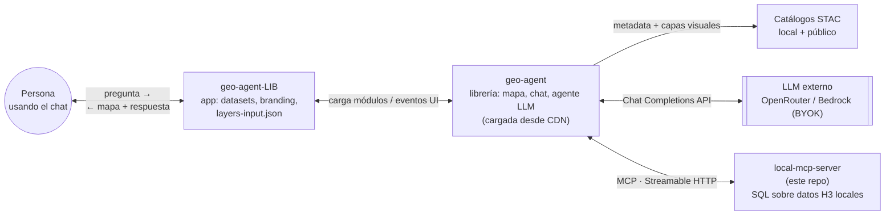
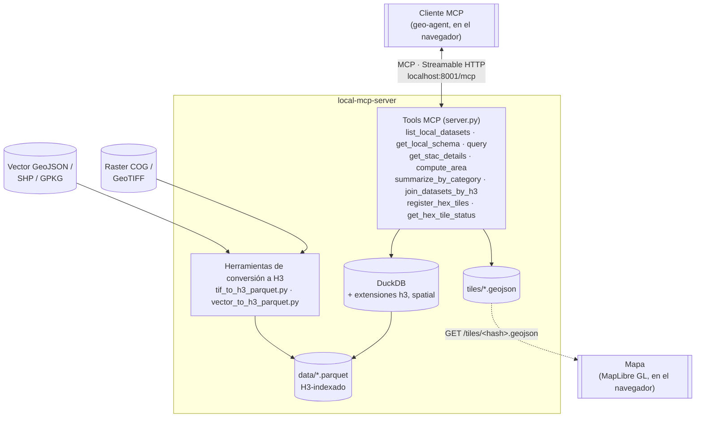

# Servidor MCP local (DuckDB + H3)

En este repositorio se creó el servidor MCP, el cual funciona como intermediario para hacer que un modelo LLM pueda establecer conexión y hacer consultas a una base de datos SQL.   
Además de este servidor, también se tienen los scripts que convierten los datos geoespaciales en una base de datps relacional en gormato H3.

1. **`tif_to_h3_parquet.py`** — convierte un raster (COG local, remoto, o
   resuelto desde un item STAC) en un `.parquet` indexado en H3: una fila
   por hexágono, con la clase mayoritaria (datos categóricos) o el promedio
   (datos continuos).
2. **`vector_to_h3_parquet.py`** — convierte un vector de polígonos (GeoJSON,
   Shapefile, GeoPackage) en un `.parquet` indexado en H3: una fila por
   cada combinación de feature y hexágono que esa geometría cubre — útil
   para límites administrativos, páramos, cuencas y cualquier capa que
   luego se quiera cruzar (por `JOIN`) con datos raster ya indexados en H3.
3. **`server.py`** — un servidor MCP que sirve esos `.parquet` locales con la herramienta `query` de SQL DuckDB, igual que el
   servidor público `duckdb-mcp.nrp-nautilus.io`, pero apuntando a mi el propio disco.

No sube nada a S3, no requiere `kubectl`, no necesita credenciales.

## Arquitectura

### Vista general del ecosistema

Este servidor es una pieza dentro de un ecosistema de tres repositorios: la app web (`geo-agent-LIB`), la librería del mapa/agente que esa app carga desde CDN ([`geo-agent`](https://github.com/boettiger-lab/geo-agent)), y este servidor de datos local.



`geo-agent-LIB` es la app configurada (datasets propios, direcciones propias); los módulos que la hacen funcionar (mapa, chat, agente LLM) vienen de la librería [`geo-agent`](https://github.com/boettiger-lab/geo-agent), cargada desde CDN. Esa librería habla con tres sistemas externos: el catálogo STAC (metadata + capas visuales), un LLM externo (razonamiento del chat), y este servidor (SQL sobre datos H3 propios).

### Este repositorio en detalle



`server.py` expone los tools MCP; todos leen/escriben a través de DuckDB (con las extensiones `h3` y `spatial` cargadas). Los `.parquet` de `data/` se generan una sola vez, offline, con los dos scripts de conversión — nunca en tiempo de consulta. `register_hex_tiles` es la única excepción que escribe en caliente: genera un `.geojson` en `tiles/` y lo sirve por HTTP directo al mapa, sin pasar por el cliente MCP.

Se recomienda tener un ambiente conda o un ambiente virtual para  ejecutar todo lo siguente.

## 1. Instalar
Clonar este repositorio

```bash
cd local-mcp-server
pip install -r requirements.txt
```

Además se necesitan los binarios de GDAL en el `PATH` (`gdalinfo`,
`gdal_translate`):

```bash
sudo apt install gdal-bin        # Ubuntu/Debian
# o
conda install -c conda-forge gdal
```

## 2. Convertir un dataset a H3 (ejemplo: colección "Coberturas")

El catálogo STAC  expone la colección
`Coberturas` (grado de conservación/transformación de ecosistemas —
1=Natural, 2=Secundaria, 3=Transformada) como un COG categórico. Para una
primera prueba rápida usar una resolución H3 gruesa (h6, ~36 km²/celda):

```bash
python tif_to_h3_parquet.py \
    --stac-item http://172.191.168.255:8082/collections/Coberturas/items/2020 \
    --output data/coberturas_h6.parquet \
    --resolution 6 \
    --labels "1=Secundaria,2=Natural,3=Transformada"
```

Si se quiere una resolución "estándar" (h8, ~0.7 km²/celda,
la misma que usa el servidor de boettiger-lab), correr:

```bash
python tif_to_h3_parquet.py \
    --stac-item http://172.191.168.255:8082/collections/Coberturas/items/2020 \
    --output data/coberturas_h8.parquet \
    --resolution 8 --parent-resolutions "6,0" \
    --labels "1=Natural,2=Secundaria,3=Transformada"
```

**Nota de tamaño/tiempo:** el raster de Coberturas es 48657×66749 píxeles
(~27m/píxel) cubriendo todo Colombia — del orden de mil millones de píxeles
válidos. A resolución h8 puede tardar bastante.
Para pruebas o iterar rápido es suficiente con un h6 o h7
El h8 solo cuando sea algo más definitivo y preciso 

El mismo comando sirve para la colección `Humedales` (humedal binario,
clase única "humedal") — solo cambiar `--stac-item` y `--labels`, ejemplo:

```bash
python tif_to_h3_parquet.py \
    --stac-item http://172.191.168.255:8082/collections/Humedales/items/Humedales30 \
    --output data/humedales_h8.parquet \
    --resolution 8 --parent-resolutions "6,0" \
    --labels "1=Humedal"
```

Y para datos **continuos** (elevación, HHContinua, etc. — no categóricos) se usa `--agg avg` en vez de `--agg mode` (que es el default), y omiten `--labels`.

### Desde un archivo local (sin STAC)

`--source` no está limitado a datos del catálogo STAC — también acepta una
ruta local directa a cualquier COG/GeoTIFF en disco:

```bash
python tif_to_h3_parquet.py \
    --source /ruta/local/mi_raster.tif \
    --output data/mi_raster_h8.parquet \
    --resolution 8 --parent-resolutions "6,0" \
    --labels "1=Clase A,2=Clase B"
```

`--stac-item` y `--source` son mutuamente excluyentes: usa `--stac-item`
cuando sea un item del stac; usar `--source` con ruta local.

## 2b. Indexar límites vectoriales (departamentos, páramos, cuencas...)

`vector_to_h3_parquet.py` hace lo mismo que el conversor de raster pero para
polígonos: convierte cada `.geojson`/`.shp`/`.gpkg` en un parquet con una
fila por cada (feature, hexágono) que esa geometría cubre — el modelo de
"tiling" que usa el resto del ecosistema para límites administrativos, no
el de "un valor agregado por celda" del raster.    
**Nota:** Para estas pruebas poner los archivos geojson en la carpeta ./data_previa

```bash
python vector_to_h3_parquet.py \
    --source data_previa/departamentos.geojson \
    --output data/departamentos_h8.parquet \
    --resolution 8 --parent-resolutions "6,0" \
    --keep-columns dpto_cnmbr,dpto_ccdgo
```

Mismo patrón para los otros archivos en `data_previa/`:

```bash
python vector_to_h3_parquet.py --source data_previa/paramos.geojson \
    --output data/paramos_h8.parquet --resolution 8 --parent-resolutions "6,0" \
    --keep-columns NM_UA,COD_CMPLJ,Area_Ha

python vector_to_h3_parquet.py --source data_previa/jurisdicciones-ambientales.geojson \
    --output data/jurisdicciones_h8.parquet --resolution 8 --parent-resolutions "6,0" \
    --keep-columns car,nombre

python vector_to_h3_parquet.py --source data_previa/subzonas-hidrograficas.geojson \
    --output data/subzonas_h8.parquet --resolution 8 --parent-resolutions "6,0" \
    --keep-columns nom_szh,COD_SZH,nom_zh,nom_ah
```

`--keep-columns` es opcional pero recomendado: sin él se conservan todas las
columnas de atributos

A diferencia del raster, esto corre en segundos incluso a resolución h8: los
33 departamentos de Colombia tilados a h8 son ~1.5M filas, generadas en
menos de un minuto, todo en local con DuckDB (no necesita GDAL como binario
aparte — `ST_Read` de la extensión `spatial` lee GeoJSON directo).

### Ejemplo real: "cobertura natural en Antioquia"

Con `departamentos_h8.parquet` y  las Coberturas
(`coberturas_h8.parquet`, generado igual que en el paso 2) se usa
 un `SEMI JOIN` por `h8` — nunca con una intersección geométrica
sobre el polígono:

```sql
WITH antioquia_hex AS (
    SELECT DISTINCT h8
    FROM read_parquet('data/departamentos_h8.parquet')
    WHERE dpto_cnmbr = 'ANTIOQUIA'
),
cobertura_en_antioquia AS (
    SELECT c.h8, c.class_label
    FROM read_parquet('data/coberturash8.parquet') c
    SEMI JOIN antioquia_hex a USING (h8)
)
SELECT class_label,
       COUNT(*) AS celdas,
       SUM(h3_cell_area(h8, 'km^2')) AS area_km2,
       ROUND(100.0 * COUNT(*) / SUM(COUNT(*)) OVER (), 1) AS pct
FROM cobertura_en_antioquia
GROUP BY class_label
ORDER BY area_km2 DESC
```

Resultado real (recorte de Coberturas a la extensión de Antioquia):

| class_label | celdas | area_km2 | % |
|---|---:|---:|---:|
| Transformada | 48,950 | 36,932.7 | 58.7% |
| Secundaria | 26,686 | 20,190.3 | 32.0% |
| Natural | 7,806 | 5,887.4 | 9.4% |

El área total ≈ 63,020 km², consistente con el área oficial de Antioquia —

Este es exactamente el patrón que el LLM del chat de geo-agent generará solo
cuando se le pregunta "¿cuánta cobertura natural hay en Antioquia?": llama
`list_datasets` → `get_schema` en ambos datasets → arma el `SEMI JOIN` de
arriba.

## 3. Levantar el servidor MCP

```bash
python server.py
```

```
DATA_DIR: /ruta/a/local-mcp-server/data
Datasets encontrados: 2 → ['coberturas_h8', 'humedales_h8']
Sirviendo MCP en http://127.0.0.1:8001/mcp
```

## 4. Conectar geo-agent a este servidor local

En el archivo de configuración de geo-agent-LIB `app/layers-input.json`:

```json
{
  "mcp_url": "http://localhost:8001/mcp"
}
```

Al pregúntar al chat algo como *"¿qué porcentaje del área tiene cobertura
natural?"* — el agente llamará `list_datasets` → `get_schema` → `query`
